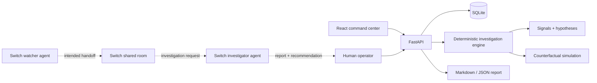

# Architecture

## Trust boundaries
- The demo API stores a local workspace in SQLite.
- The investigation engine is deterministic and transparent.
- The experiment is modeled, not executed against a real database.
- Switch agents are separate processes managed by Switch; this repository provides a room template and setup instructions.
- The human decision endpoint records an approval or rejection. It does not execute a recovery action.

## Data lifecycle
1. Seed an incident and service graph.
2. Query overview and incident evidence.
3. Run investigation and append an audit event.
4. Run counterfactual experiment and attach the result.
5. Record human decision and append audit event.
6. Export a report with an explicit simulation notice.
